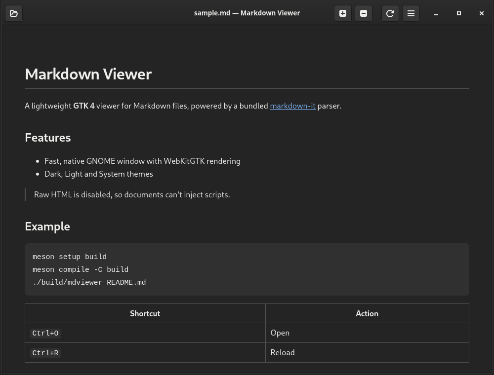

# Markdown Viewer

A lightweight GTK 4 / WebKitGTK viewer for Markdown files on GNOME.



Markdown is rendered by a bundled [markdown-it](https://github.com/markdown-it/markdown-it) parser. The parser JavaScript is embedded into the executable as a GResource, so the built app does not need npm, Node.js or a separate Markdown renderer at runtime.

## Features

- Native GTK 4 window with WebKitGTK rendering
- Dark, Light and System themes
- Zoom in, zoom out and reset
- Reload the current file in place
- Relative image links resolve against the Markdown file's directory
- Raw HTML in documents is disabled for safety

## Build on Ubuntu 26.04

Install build tools and the GTK/WebKit development dependencies if they are not already present:

```bash
sudo apt update
sudo apt install build-essential meson ninja-build valac libgtk-4-dev libwebkitgtk-6.0-dev npm
```

From this project directory, fetch the pinned parser source and embed it:

```bash
./scripts/fetch-markdown-it.sh
meson setup build
meson compile -C build
./build/mdviewer
```

If `build` already exists, use `meson setup --reconfigure build` instead.

To build a Debian package (requires `dpkg-dev`):

```bash
meson compile -C build package
```

## Usage

Open a file from the command line, or use the Open button in the header bar:

```bash
mdviewer README.md
```

| Shortcut               | Action      |
|------------------------|-------------|
| `Ctrl+O`               | Open file   |
| `Ctrl+R`               | Reload file |
| `Ctrl++` / `Ctrl+=`    | Zoom in     |
| `Ctrl+-`               | Zoom out    |
| `Ctrl+0`               | Reset zoom  |

The hamburger menu also offers Theme (Dark, Light, System), Zoom, About and Quit.

## Notes

- Raw HTML in Markdown is disabled (`html: false`). Markdown source is base64-encoded before being inserted into the generated document, so its contents cannot break out into script syntax.
- The document canvas fills the full WebKit viewport in both themes.
- The bundled `markdown-it` parser and its dependencies are MIT/BSD-2-Clause licensed; see [THIRD_PARTY_NOTICES.md](THIRD_PARTY_NOTICES.md). Keep those notices when redistributing the app.

## License

Copyright (C) 2026 JOD

This program is free software: you can redistribute it and/or modify it under the terms of the GNU General Public License as published by the Free Software Foundation, either version 3 of the License, or (at your option) any later version.

This program is distributed in the hope that it will be useful, but WITHOUT ANY WARRANTY; without even the implied warranty of MERCHANTABILITY or FITNESS FOR A PARTICULAR PURPOSE. See [LICENSE](LICENSE) for the full text of the GNU General Public License v3.0.
